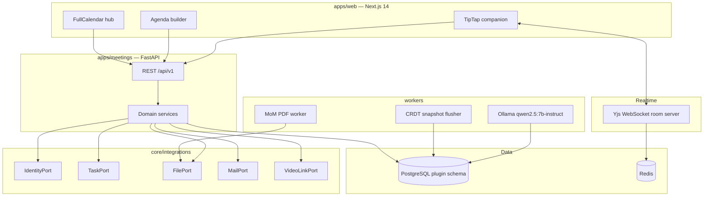

# Technical Architecture Document

## xone-meeting-plugin (greenfield)

| Field | Value |
| --- | --- |
| Document ID | TAD-XMP-001 |
| Version | 1.0.0 |
| Status | Approved for implementation |
| PRD | PRD-XMP-001 |
| Supersedes | `TAD_Xone_2.md` (Xone embed variant; not this build) |

---

## 1. Architectural principles

1. **Standalone system of record.** Plugin-owned tables only. Do not `ALTER` or reuse `governance_*`.
2. **Ports and adapters.** Identity, Task, File, Mail, and Video live in `core/integrations/`. Default adapters are local. Optional Xone adapters must not leak into `apps/meetings/services/`.
3. **Local commit first.** Scheduling and notes persist even if video providers or Ollama fail. External sync is asynchronous with circuit breaker and retry.
4. **CRDT for notes.** TipTap + Yjs over WebSockets. Snapshots persist to PostgreSQL. `APPROVED` MoM refuses Yjs writes.
5. **Human gate on AI.** Ollama writes candidate actions only. Workers never call TaskPort.
6. **Layering.** HTTP in `api/`; business logic in `services/`; ORM in `models/`; DTOs in `schemas/`; prompts in `prompts/`; background work in `workers/`.

---

## 2. Repository layout

Allowed root folders: `apps`, `core`, `workers`, `infrastructure`, `config`, `docs`, `tests`, `scripts`.

| Path | Responsibility |
| --- | --- |
| `apps/meetings/api/` | Routing, auth, request parsing |
| `apps/meetings/services/` | Meeting, agenda, conflict, recurrence, governance |
| `apps/meetings/models/` | ORM definitions |
| `apps/meetings/schemas/` | Pydantic DTOs |
| `apps/meetings/prompts/` | Ollama templates |
| `apps/meetings/tests/` | Domain tests |
| `apps/web/` | Next.js 14 UI (FullCalendar, TipTap). No direct DB or env-file access |
| `core/typing/`, `core/errors/`, `core/helpers/`, `core/db/` | Shared types, exceptions, helpers, session |
| `core/integrations/` | Ports and adapters (never `core/utils/`) |
| `workers/` | Ollama job, CRDT snapshot flush, PDF |
| `infrastructure/gateway/` | Gateway config |
| `config/` | Environment and product configuration |
| `tests/e2e/` | End-to-end flows |
| `docs/` | Architecture notes only |

---

## 3. System context

---

## 4. Data schema (plugin-owned names)

Do not copy Xone table names.

### 4.1 Core tables

- `meetings` — `id`, `title`, `starts_at`, `ends_at`, `timezone`, `status`, `series_id`, `rrule`, `organizer_id`, `join_url`, `join_provider`, `notes_snapshot`, `yjs_room_id`, `mom_status`, `allow_overlap`, `created_at`, `updated_at`
- `meeting_attendees` — `meeting_id`, `principal_id`, `kind` (`internal` \| `external`), `role`
- `meeting_agenda_items` — `id`, `meeting_id`, `item_order`, `title`, `estimated_minutes`, `presenter_id`, `description`, `is_covered`
- `meeting_attachments` — `id`, `agenda_item_id`, `file_key`, `filename`, `content_type`
- `meeting_actions` — `id`, `meeting_id`, `body`, `assignee_id`, `due_at`, `is_candidate`, `linked_task_id`, `status`
- `meeting_decisions` — `id`, `meeting_id`, `body`, `owner_id`
- `meeting_transcripts` — `id`, `meeting_id`, `raw_text`, `summary_json`, `job_status`
- `meeting_approvals` — `id`, `meeting_id`, `approver_id`, `decision`, `decided_at`
- `tasks` — local TaskPort default: `id`, `title`, `assignee_id`, `due_at`, `status`, `source_action_id`

### 4.2 Constraints and indexes

- Unique `(meeting_id, item_order)` on agenda items.
- Indexes: `meetings (starts_at, ends_at)`, `meeting_attendees (principal_id, meeting_id)`, `meetings (series_id)`.
- Conflict query: overlapping `[starts_at, ends_at)` for a shared attendee or resource where `status` is not `CANCELLED`.

### 4.3 Status machines

- Meeting: `SCHEDULED` → `IN_PROGRESS` → `COMPLETED`; also `CANCELLED`, `POSTPONED`. Illegal: `COMPLETED` → `SCHEDULED`.
- MoM: `DRAFT` → `SUBMITTED` → `APPROVED`; `SUBMITTED` → `REJECTED` → `DRAFT`. `APPROVED` is terminal except audited admin versioning (out of v1 default).

---

## 5. API (`/api/v1`)

| Method | Path | Purpose | Permission |
| --- | --- | --- | --- |
| GET | `/meetings` | Range / view / resource query | authenticated |
| POST | `/meetings/check-overlap` | Dry-run conflicts | `manage_meetings` |
| POST | `/meetings` | Create (runs overlap) | `manage_meetings` |
| PATCH | `/meetings/{id}` | Reschedule or metadata | `manage_meetings` |
| GET/PUT | `/meetings/{id}/agenda` | Ordered agenda | read / `manage_meetings` |
| POST | `/meetings/{id}/agenda/{item_id}/attachments` | Pre-reads | `manage_meetings` |
| GET | `/meetings/{id}/ws` | Yjs upgrade | `edit_notes` |
| POST | `/meetings/{id}/actions` | Flag from notes | `edit_notes` |
| POST | `/actions/{id}/accept-candidate` | Clear `is_candidate` | `manage_meetings` |
| POST | `/actions/{id}/convert-task` | TaskPort create | `convert_task` |
| POST | `/meetings/{id}/transcripts` | Enqueue Ollama job | `manage_meetings` |
| POST | `/meetings/{id}/mom/submit` | DRAFT → SUBMITTED | `manage_meetings` |
| POST | `/meetings/{id}/mom/approve` | Lock | `approve_mom` |
| GET | `/meetings/{id}/mom.pdf` | Approved pack | authenticated |

JWT on REST and WebSocket connect. Validate all bodies with Pydantic schemas. Timeouts on outbound adapters must be explicit.

---

## 6. Operational sequences

### 6.1 Booking and overlap

1. UI posts `check-overlap` with window and principal IDs.
2. Conflict service returns 200 (clear) or 409 with conflicts and suggested slots.
3. Create persists locally. `allow_overlap=true` writes an audit row.
4. MailPort queues invites asynchronously. VideoLinkPort is optional and non-blocking.

### 6.2 Convert to task

1. UI opens modal pre-filled from the action.
2. If `is_candidate` is true, reject convert until accept-candidate.
3. Service calls TaskPort.create; stores `linked_task_id`; action status `CONVERTED`.
4. Companion shows a task badge; status is read through TaskPort.

### 6.3 CRDT notes

1. Room id = meeting id. Snapshot worker flushes Yjs document to `notes_snapshot`.
2. Client caches in IndexedDB; reconnect merges.
3. When `mom_status=APPROVED`, WebSocket writes are rejected.

### 6.4 AI summarization

1. Transcript upload enqueues a worker job.
2. Worker calls local Ollama with templates in `apps/meetings/prompts/`.
3. Persist `summary_json`; insert `meeting_actions` with `is_candidate=true`.
4. Worker must not call TaskPort.

---

## 7. Technology choices

| Concern | Choice | Rationale |
| --- | --- | --- |
| Calendar | FullCalendar | Month, Week, Day, Resource Timeline and DnD |
| Notes | TipTap + Yjs | CRDT convergence without last-write-wins |
| API | FastAPI / Python 3.12 | Typed services, async workers |
| Data | PostgreSQL + Redis | SoR + presence / queue |
| AI | Ollama `qwen2.5:7b-instruct` | On-premise; no cloud leak |
| PDF | Worker-generated from approved MoM | Governance artefact, not live editor dump |

Pin dependency versions. Configuration is environment-external. Fail fast on missing Ollama URL only for the AI worker process, not the API process.

---

## 8. Risks

| ID | Risk | Mitigation |
| --- | --- | --- |
| R-01 | Video provider down | Local SoR; async link sync; circuit breaker |
| R-02 | Weak AI extraction | Candidates only; mandatory human accept |
| R-03 | Concurrent notes / disconnect | Yjs + IndexedDB + snapshot flush |
| R-04 | Ollama latency | Async job; UI poll or subscribe; API stays up |

---

## 9. Quality gates

- Overlap engine unit tests (adjacent, nested, cancelled excluded, `allow_overlap`).
- Recurrence expansion tests (this instance vs this-and-following).
- Convert rejects candidates; stores `linked_task_id`.
- APPROVED rejects note and agenda writes.
- CRDT chaos: drop WebSocket mid-edit; snapshot intact after reconnect.
- Ollama tests use a fake client; no network LLM in CI.
