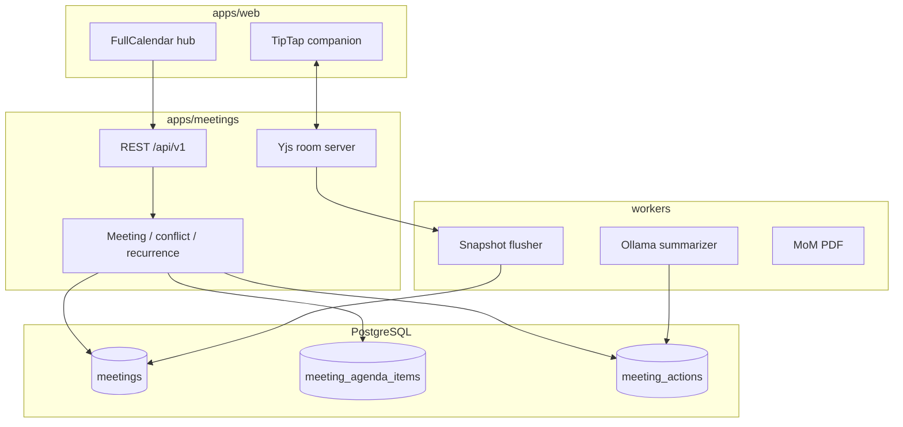

# Work Breakdown Structure and Execution Plan

## xone-meeting-plugin (greenfield)

| Field | Value |
| --- | --- |
| Document ID | WBS-XMP-001 |
| Version | 1.0.0 |
| PRD | PRD-XMP-001 |
| TAD | TAD-XMP-001 |
| Supersedes | Prior Xone 2.0 governance WBS (embed variant) |

This plan implements a **standalone** plugin. Do not sequence work as `ALTER governance_meetings` or Resource Management reuse.

---

## 1. Execution topology

---

## 2. Work breakdown

### Phase 0 — Foundation (blocking)

- **0.1** Repository layout: `apps/meetings`, `apps/web`, `core`, `workers`, `config`, `infrastructure`, `docs`, `tests`, `scripts`
- **0.2** Environment config for dev / test / staging / prod; fail fast on missing required keys for each process
- **0.3** JWT auth and RBAC: `manage_meetings`, `edit_notes`, `approve_mom`, `convert_task`
- **0.4** PostgreSQL migrations for plugin schema (`meetings`, attendees, agenda, attachments, actions, decisions, transcripts, approvals, local `tasks`)
- **0.5** Ports in `core/integrations/`: Identity, Task (local), File, Mail, VideoLink

### Phase 1 — Interactive calendar (P1)

- **1.1** Meeting CRUD and attendee bindings
- **1.2** Overlap engine and `allow_overlap` audit (`POST /meetings/check-overlap`)
- **1.3** Recurrence expand / edit / cancel this instance or this-and-following
- **1.4** FullCalendar Month, Week, Day, Resource Timeline
- **1.5** Drag-and-drop and resize → PATCH + overlap

### Phase 2 — Timeboxed agenda (P2)

- **2.1** Agenda item CRUD and reorder
- **2.2** Duration sum versus slot warning
- **2.3** Pre-read upload / list / download
- **2.4** Covered flag for live mode

### Phase 3 — Collaborative companion (P3)

- **3.1** Yjs WebSocket server with JWT on connect
- **3.2** TipTap binding and presence
- **3.3** IndexedDB offline cache and reconnect merge
- **3.4** Snapshot worker into `meetings.notes_snapshot`
- **3.5** Live agenda timer and overtime UI
- **3.6** Flag Action Item / Key Decision

### Phase 4 — Execution (P4)

- **4.1** Local `tasks` table and TaskPort
- **4.2** Convert modal, `linked_task_id`, lock converted action
- **4.3** Reject convert while `is_candidate=true`
- **4.4** Task status projection in companion
- **4.5** Optional host TaskPort adapter (after MVP)

### Phase 5 — AI and governance (P5)

- **5.1** Transcript ingest and job queue
- **5.2** Ollama `qwen2.5:7b-instruct` with `apps/meetings/prompts/`
- **5.3** Candidate actions (`is_candidate=true`); human accept
- **5.4** MoM submit / approve / reject and lock
- **5.5** PDF export of approved pack

---

## 3. Sprint roadmap

| Sprint | Outcome | Exit criteria |
| --- | --- | --- |
| 1 | Schema, auth, meeting CRUD, overlap API | 409 on conflict; `allow_overlap` audited |
| 2 | Four FullCalendar views, DnD, recurrence | FR-01, FR-02, FR-03 |
| 3 | Agenda builder, attachments, overbox warning | FR-05, FR-06 |
| 4 | Yjs companion, timers, flagging | FR-07, FR-08, FR-09 |
| 5 | Convert-to-task and status badge | FR-10; candidates blocked |
| 6 | Ollama summary, MoM lock, PDF | FR-11, FR-12, FR-13 |

Core loop that must work without AI:

**Book (conflict warn) → agenda → live notes → flag actions → convert to tasks → submit / approve MoM → PDF.**

---

## 4. Risk mitigation during execution

### R-01 — Video or calendar provider outage

Commit meeting locally first. Wrap VideoLinkPort and MailPort in timeouts, circuit breaker, and queued retry. UI still shows the meeting.

### R-02 — Low AI extraction accuracy

Worker writes candidates only. Convert endpoint rejects `is_candidate=true`. PM accept is mandatory.

### R-03 — Concurrent editors and disconnects

Yjs CRDT, IndexedDB cache, snapshot flush, authenticated reconnect. Chaos-test WebSocket drop before Sprint 4 exit.

---

## 5. Pre-release quality gates

- [ ] Foreign keys protect `meetings` → agenda, actions, attendees
- [ ] Overlap p95 &lt; 200 ms under concurrent booking
- [ ] Recurrence this-instance vs this-and-following covered by tests
- [ ] Convert refuses candidates; stores `linked_task_id`
- [ ] `APPROVED` rejects TipTap writes and agenda PATCH
- [ ] CRDT reconnect after forced disconnect preserves both users' edits
- [ ] Ollama path uses a fake client in CI; no cloud LLM
- [ ] PDF contains attendees, agenda, notes, decisions, actions
- [ ] No secrets or PII in logs
